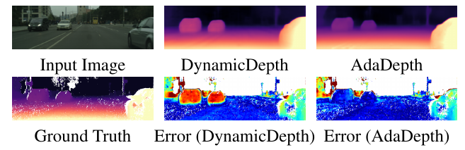
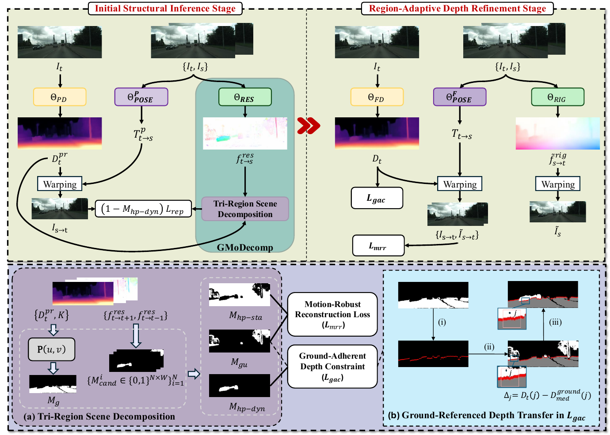
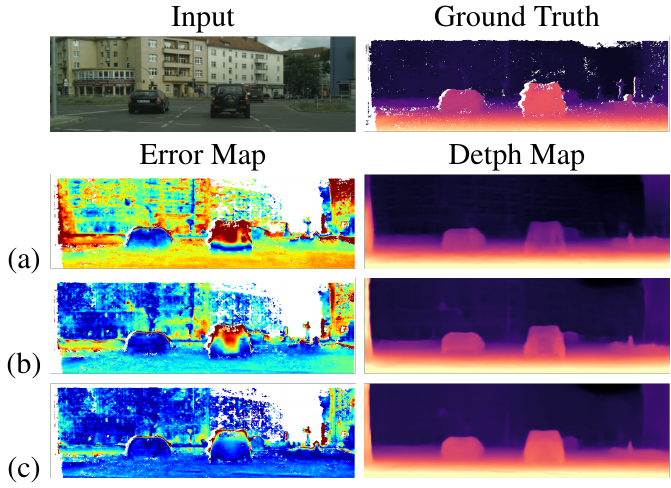

<h1 align="center">AdaDepth</h1>
<h3 align="center">Exploiting Inherent Scene Information for<br>Self-Supervised Depth Estimation in Dynamic Scenes</h3>
<h3 align="center">AAAI 2026</h3>

<p align="center">
Xuanang Gao<sup>1</sup>, Xiongbin Wu<sup>1</sup>, Zhiwei Ning<sup>1</sup>, Runze Yang<sup>1,2</sup>,<br>
Zhonglong Zheng<sup>3</sup>, Jie Yang<sup>1</sup>, Wei Liu<sup>1</sup>
</p>
<p align="center"><sup>1</sup>Shanghai Jiao Tong University · <sup>2</sup>Macquarie University · <sup>3</sup>Zhejiang Normal University</p>

<p align="center">
<a href="https://ojs.aaai.org/index.php/AAAI/article/view/42414"></a>
<a href="#pretrained-models"></a>
<a href="#training"></a>
<a href="LICENSE"></a>
</p>

<p align="center"></p>

**AdaDepth** learns monocular depth in dynamic scenes from unlabeled video. It combines geometry–motion scene decomposition with region-adaptive refinement to improve depth estimation on moving objects.

## Overview

<p align="center"></p>

- **Structural inference:** jointly learn a depth prior and use geometry and residual motion to decompose the scene.
- **Region-adaptive refinement:** combine motion-robust reprojection with a ground-adherent depth constraint.
- **Flexible backbones:** Monodepth2, LiteMono-8M, and DiffNet.

## Setup

```bash
git clone https://github.com/xagao/AdaDepth.git
cd AdaDepth

conda create -n adadepth python=3.9 -y
conda activate adadepth
pip install -r requirements.txt
```

## Data

Prepare [KITTI](https://www.cvlibs.net/datasets/kitti/), [Cityscapes](https://www.cityscapes-dataset.com/), or [Waymo Open](https://waymo.com/open/). Image lists are provided in `splits/`.

```text
data/
├── kitti_raw_data/
│   └── 2011_09_26/2011_09_26_drive_0001_sync/image_02/data/
├── cityscapes_preprocessed/
│   └── <city>/                  # stacked training triplets and *_cam.txt
├── cityscapes/
│   ├── leftImg8bit/
│   └── camera/
└── waymo_MDE/
    └── <split>/<sequence>/FRONT/
        ├── rgb/original/        # images and cam.json
        └── depth/              # evaluation LiDAR
```

Cityscapes training uses vertically stacked image triplets, with the bottom 25% removed, following the existing preprocessing pipeline. Ground-truth depth and region masks are used by the evaluation script. See [data preparation](docs/data.md) for layout details.

## Pretrained Models

Download a model archive and extract it into `checkpoints/`. Each model contains `encoder_ref.pth`, `depth_ref.pth`, and `model_info.json`.

| Dataset | Backbone | Resolution | Abs Rel ↓ | Sq Rel ↓ | RMSE ↓ | a1 ↑ | Download |
|:--|:--|:--:|--:|--:|--:|--:|:--:|
| Cityscapes | **LiteMono-8M** | 512×192 | **0.085** | **0.736** | **5.213** | **0.918** | [Model](https://github.com/xagao/AdaDepth/releases/download/v1.0.0/AdaDepth_LiteMono8M_Cityscapes.zip) |
| Cityscapes | DiffNet | 512×192 | 0.088 | 0.781 | 5.317 | 0.916 | [Model](https://github.com/xagao/AdaDepth/releases/download/v1.0.0/AdaDepth_DiffNet_Cityscapes.zip) |
| KITTI | Monodepth2 | 640×192 | 0.113 | 0.852 | 4.779 | 0.879 | [Model](https://github.com/xagao/AdaDepth/releases/download/v1.0.0/AdaDepth_Monodepth2_KITTI.zip) |
| Waymo Open | Monodepth2 | 480×320 | 0.130 | 1.531 | 6.403 | 0.869 | [Model](https://github.com/xagao/AdaDepth/releases/download/v1.0.0/AdaDepth_Monodepth2_Waymo.zip) |

Metrics above are from the original evaluation logs. Full metrics and file checksums are recorded in [`models.json`](models.json).

```bash
unzip AdaDepth_LiteMono8M_Cityscapes.zip -d checkpoints/
```

## Evaluation

### Cityscapes

```bash
python evaluate_depth.py --dataset cityscapes \
  --data-path /path/to/cityscapes \
  --weights checkpoints/AdaDepth_LiteMono8M_Cityscapes \
  --backbone litemono --model lite-mono-8m \
  --height 192 --width 512 \
  --split-file splits/cityscapes/test_files.txt \
  --gt-path /path/to/cityscapes/gt_depths \
  --output results/cityscapes.json
```

For DiffNet, select `--backbone diffnet` and its checkpoint directory. Add `--regions --mask-path /path/to/val_mask` to evaluate object-class regions.

### KITTI

```bash
python evaluate_depth.py --dataset kitti \
  --data-path /path/to/kitti_raw_data \
  --weights checkpoints/AdaDepth_Monodepth2_KITTI --backbone monodepth2 \
  --height 192 --width 640 \
  --split-file splits/kitti/eigen/test_files.txt \
  --gt-path /path/to/gt_depths.npz \
  --output results/kitti.json
```

### Waymo Open

```bash
python evaluate_depth.py --dataset waymo \
  --data-path /path/to/waymo_MDE \
  --weights checkpoints/AdaDepth_Monodepth2_Waymo --backbone monodepth2 \
  --height 320 --width 480 --img-ext .jpg \
  --split-file splits/waymo/test_files.txt \
  --output results/waymo.json
```

Add `--regions` for moving-object and static-object evaluation when the Waymo masks are available. Evaluation records its depth range, scaling, log base, and region settings in the output JSON. Use `--device cpu` for CPU inference.

## Training

Dataset configurations are in `configs/`. Set your data path and choose `litemono`, `monodepth2`, or `diffnet` as the final-depth backbone.

```bash
# KITTI
python train.py --config configs/kitti.json \
  --data-path /path/to/kitti_raw_data --output-dir runs/kitti

# Cityscapes: use the preprocessed training triplets
python train.py --config configs/cityscapes.json \
  --data-path /path/to/cityscapes_preprocessed --output-dir runs/cityscapes

# Waymo Open
python train.py --config configs/waymo.json \
  --data-path /path/to/waymo_MDE --output-dir runs/waymo
```

The released training implementation uses a 10-epoch prior stage, 5-epoch pseudo-rigid stage, and 20-epoch depth-refinement stage. L_gac settings are configurable, including contact detection, local ground statistics, offset aggregation, and random local propagation. See [training settings](docs/training.md) and [L_gac configuration](docs/GROUND_ADHERENT.md).

## Qualitative Results

<p align="center"></p>
<p align="center">Cityscapes comparison: (a) DynamicDepth, (b) depth prior, (c) AdaDepth.</p>

## Citation

```bibtex
@inproceedings{gao2026adadepth,
  title={AdaDepth: Exploiting Inherent Scene Information for Self-Supervised Depth Estimation in Dynamic Scenes},
  author={Gao, Xuanang and Wu, Xiongbin and Ning, Zhiwei and Yang, Runze and Zheng, Zhonglong and Yang, Jie and Liu, Wei},
  booktitle={Proceedings of the AAAI Conference on Artificial Intelligence},
  volume={40},
  number={6},
  pages={4185--4193},
  year={2026},
  doi={10.1609/aaai.v40i6.42414}
}
```

## Acknowledgements

We thank the authors of [Monodepth2](https://github.com/nianticlabs/monodepth2), [ManyDepth](https://github.com/nianticlabs/manydepth), [Lite-Mono](https://github.com/noahzn/Lite-Mono), [DiffNet](https://github.com/brandleyzhou/DIFFNet), and [Dynamo-Depth](https://github.com/JeffWang987/Dynamo-Depth) for their open-source work.

## License

This code is available for non-commercial research under the inherited [license](LICENSE). Third-party source headers are retained.
